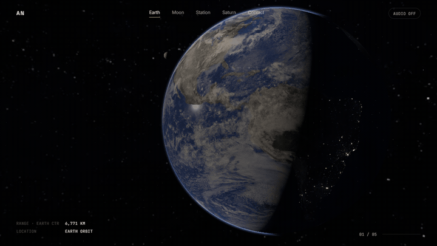
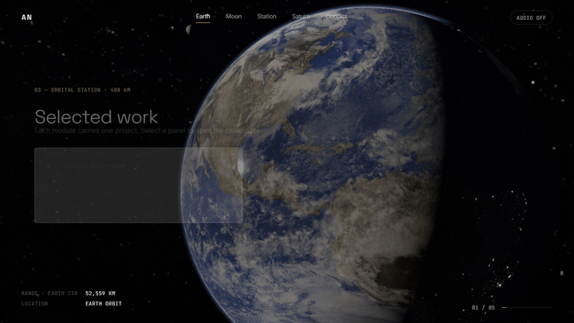
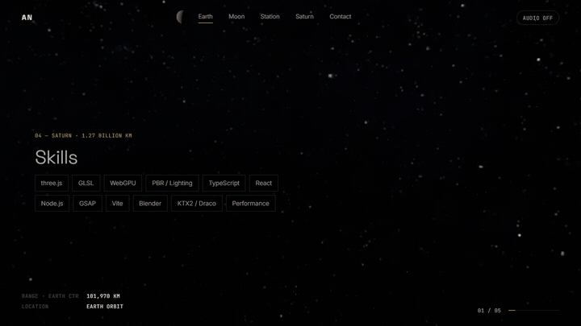

# THE JOURNEY — Photorealistic 3D Space Portfolio

<div align="center">

[](https://www.typescriptlang.org/)
[](https://threejs.org/)
[](https://vitejs.dev/)
[](https://greensock.com/)
[](https://github.com/darkroomengineering/lenis)
[](LICENSE)

An award-level 3D portfolio website with a photorealistic, physically grounded space theme. The visitor travels through the Solar System like a spacecraft: weighted inertial camera motion, true vacuum lighting, real astronomical star data, and zero game/sci-fi cliches.

[Live Demo](#) · [Report Bug](#) · [Request Feature](#)

</div>

---

## Previews

### 01. Earth Orbit to Lunar Flyby
*Low Earth orbit with Rayleigh/Mie atmospheric limb scattering, city lights on the night side, soft terminator, and transition to a close lunar flyby.*

<div align="center">
  
</div>

---

### 02. Orbital Station & Interactive Case Studies
*Approach an ISS-style modular station (PBR aluminum, thermal MLI foil, emissive windows). Clicking any module panel triggers a smooth 3D camera zoom into the case study overlay.*

<div align="center">
  
</div>

---

### 03. Saturn Rings & Deep Space Departure
*Saturn banded atmosphere, ring transparency with Cassini division, mutual planet-ring shadows, interactive skill moonlets in the ring plane, and deep space departure facing the Sun disc & lens flare.*

<div align="center">
  
</div>

---

## Creative Concept: "The Journey"

The experience is designed as a calm, cinematic voyage across 5 celestial waypoints:

| Section | Celestial Location | Real Scale & Highlights |
|---|---|---|
| **01. Hero** | Low Earth Orbit (408 km) | Custom Rayleigh-Mie atmosphere shader, ocean GGX specular glints, dark-side city lights |
| **02. About** | Moon Flyby (384,400 km) | Surface relief bump displacement, Hapke opposition surge regolith shader |
| **03. Projects** | Orbital Station | PBR modular station, interactive emissive panels, focus-trapped case study overlay |
| **04. Skills** | Saturn Rings | Ring transparency, mutual analytic shadows (planet ↔ rings), interactive moonlet orbits |
| **05. Contact** | Deep Space | Sun disc with Eddington limb darkening, corona billboard, procedural lens flare |

---

## Realism & Engineering Highlights

- **Physically Based Vacuum Lighting**:
  - Exactly **ONE** primary `DirectionalLight` acts as the Sun.
  - Zero fake ambient fog or floating dust; faint 2% `HemisphereLight` starlight fill preserves deep vacuum shadows.
  - Mutual analytical shadows: ring shadow cast across Saturn and planet shadow cut into the rings are computed analytically in GLSL fragment shaders without heavy shadow-map passes.
- **Real Astronomical Star Data**:
  - Starfield generated from the **HYG Database v4.0** (combining Hipparcos, Yale Bright Star, and Gliese catalogues).
  - 15,598 stars packed into a compact binary format (`stars.bin`, 304 KB).
  - Star apparent magnitudes control point size and brightness; B-V color indices are converted via blackbody curves to realistic stellar temperatures. Zero atmospheric twinkle.
- **Continuous 60 FPS Performance**:
  - Single `WebGLRenderer` and unified clamped `requestAnimationFrame` loop.
  - Built-in **Adaptive Quality Manager**: monitors a rolling frame-time average and automatically adjusts DPR (up to 2.0 on desktop, 1.0 on mobile) and selectively disables expensive post-processing passes (SMAA, grain, chromatic aberration) when under load.
  - Logarithmic depth buffer handles near-far distances from `0.01` to `20,000` units with zero Z-fighting.
- **Photographic Post-Processing**:
  - `postprocessing` (pmndrs) pipeline: HDR Bloom with high threshold (only the Sun, specular glints, and city lights bloom), subtle film grain, natural vignette, and depth of field active only during close flybys.
- **Full Accessibility**:
  - Semantic HTML text layer with keyboard navigation.
  - High contrast ratio, visible focus outlines, and a `"Simple view (no 3D)"` link.
  - Automatic `prefers-reduced-motion` detection (disables inertia drift and post-processing tilt).

---

## Easy Content Editing: `settings.json`

All portfolio content is decoupled from 3D logic. Everything can be edited in a single file at the root of the project:

```
👉 settings.json
```

```json
{
  "personal": {
    "brand": "AN",
    "name": "Phạm Thái Hòa An",
    "role": "Creative Developer · WebGL / Three.js",
    "tagline": "I build calm, physically grounded interfaces for the web.",
    "location": "Ho Chi Minh City, Vietnam",
    "email": "hello@example.com"
  },
  "sections": {
    "hero": { ... },
    "about": { ... },
    "projects": { "items": [ ... ] },
    "skills": { "items": [ ... ] },
    "contact": { ... }
  },
  "ui": { ... },
  "seo": { ... }
}
```

Updating `settings.json` immediately re-populates the entire website layout, projects list, 3D moonlet positions, telemetry readouts, and metadata without modifying any 3D code.

---

## Getting Started

### Prerequisites
- [Node.js](https://nodejs.org/) (version 18 or newer)
- npm (version 9 or newer)

### Installation
```bash
# Clone the repository
git clone https://github.com/your-username/3d-space-portfolio.git
cd 3d-space-portfolio

# Install dependencies
npm install

# Start local development server
npm run dev
```

Visit `http://localhost:5173/` in your browser. Press **`D`** on your keyboard anytime to open the live lil-gui debug panel.

### Production Build
```bash
npm run build
```
Compiles and tree-shakes optimized bundles into `dist/`.

### Automated Verification
```bash
npm run check
```
Runs strict TypeScript compilation checks and the automated asset verification test.

---

## Tech Stack

| Domain | Technologies |
|---|---|
| **Core Framework** | [Vite](https://vitejs.dev/) + Vanilla [TypeScript](https://www.typescriptlang.org/) |
| **3D Rendering** | [Three.js](https://threejs.org/) (latest r187), GLSL shaders |
| **Motion & Scroll** | [GSAP](https://greensock.com/) + [ScrollTrigger](https://greensock.com/scrolltrigger/), [Lenis](https://github.com/darkroomengineering/lenis) |
| **Post-Processing** | [postprocessing (pmndrs)](https://github.com/pmndrs/postprocessing) (Bloom, SMAA, Noise, Vignette, Chromatic Aberration, DoF) |
| **Assets & Compression** | WebP / KTX2 (Basis Universal), Draco glTF loader |
| **Debug UI** | [lil-gui](https://lil-gui.georgealways.com/) |

---

## 3D Asset & Texture Pipeline

### Texture Datasets
All textures are sourced from NASA public domain datasets and Solar System Scope (CC BY 4.0):
- Earth Day, Night Lights, Clouds, Specular, Normal: `public/assets/textures/earth/`
- Moon Albedo and Displacement Bump: `public/assets/textures/moon/`
- Saturn Bands and Ring Alpha: `public/assets/textures/saturn/`
- Milky Way Panorama: `public/assets/textures/sky/`

### Optional KTX2 / Basis Universal Compression
To generate GPU-native compressed textures (`.ktx2`), run:
```bash
bash scripts/to_ktx2.sh
```
The application dynamically checks `public/assets/ktx2.json` and automatically utilizes Basis Universal WebAssembly transcoders when available.

---

## Deployment

### Vercel
```bash
npx vercel
```
*Settings*: Framework: `Vite`, Build Command: `npm run build`, Output Directory: `dist`.

### Netlify
```bash
npx netlify deploy --prod
```
Or create a `netlify.toml`:
```toml
[build]
  command = "npm run build"
  publish = "dist"
```

---

## Credits & Attribution

- **Planetary Textures**: [Solar System Scope](https://www.solarsystemscope.com/textures/) — Licensed under [CC BY 4.0](https://creativecommons.org/licenses/by/4.0/).
- **Star Catalogue**: [HYG Database](https://github.com/astronexus/HYG-Database) — Combined Hipparcos, Yale Bright Star, and Gliese catalogues. Licensed under [CC BY-SA 2.5](https://creativecommons.org/licenses/by-sa/2.5/).
- **Atmospheric & Cloud Imagery**: NASA Visible Earth project.
- **Audio Synthesis**: Procedural Web Audio API sound synthesis (zero external audio files).

---

## License

This project is licensed under the [MIT License](LICENSE).
